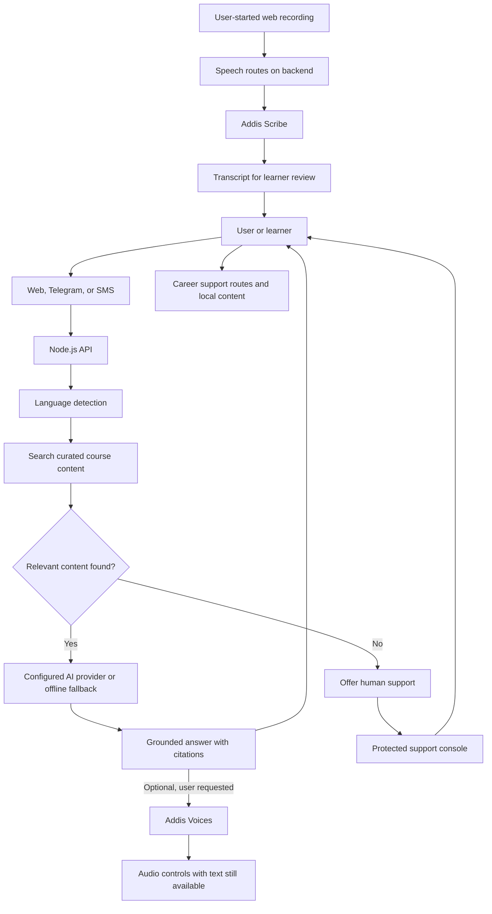

# INCLUSIVE

## Accessible, Multilingual Learning and Career Support

**INCLUSIVE** is an accessibility-focused digital platform intended to make learning, information, and career support easier to access for learners and underserved communities.

The current application combines a course-grounded assistant, multilingual web chat, optional Addis AI speech services on the web and Telegram, career-support workflows, and human assistance through a web interface, Telegram bot, and SMS text route. It searches curated content before answering course questions and offers human support when its knowledge base cannot support a reliable answer.

> **Our guiding principle: Reliable information first. AI assistance second. Human support whenever needed.**

---

## 1. The Problem and Our Approach

Learners and people with disabilities can face barriers when accessing educational resources, digital services, employment information, and communication platforms. These barriers may include:

- Educational information that is difficult to understand or access.
- Limited availability of information in local languages.
- Websites and applications that are difficult to use with assistive technologies.
- Difficulty communicating through text-only interfaces.
- Limited access to career information and human assistance.

INCLUSIVE brings together curated educational content, accessible web interactions, speech features, career-support workflows, multiple communication channels, and human handoff. The assistant checks course materials before using an AI answer provider. If relevant material is not found, it does not ask a model to invent an answer; it explains the limitation and offers human support.

---

## 2. Main Features

### 2.1 Course-Grounded Learning Assistant

- Searches the curated course knowledge base before generating an answer.
- Returns source citations for answers grounded in retrieved course material.
- The web widget can request replies in English, Amharic, Tigrinya, Afaan Oromo, Somali, or Arabic. Course sources remain reviewed in English and Amharic.
- Offers a human-support option when relevant supporting content is unavailable.
- Uses a built-in offline provider as a no-network fallback when matching content exists.

### 2.2 Language Support

Course-chat and speech-service languages are different capabilities:

- **Web chat reply languages:** English (`en`), Amharic (`am`), Tigrinya (`ti`), Afaan Oromo (`om`), Somali (`so`), and Arabic (`ar`), using the selected language when the configured AI provider supports it.
- **Reviewed course content:** English and Amharic. Replies in other languages are generated from retrieved source passages and retain citations; their wording has not been independently reviewed.
- **Addis Scribe speech-to-text:** English (`en`), Amharic (`am`), Afaan Oromo (`om`), and Tigrinya (`ti`).
- **Addis Voices text-to-speech:** Amharic (`am`), Afaan Oromo (`om`), and Tigrinya (`ti`), subject to available voices and service configuration.
Speech and chat are separate capabilities. Addis speech-to-text supports English, Amharic, Afaan Oromo, and Tigrinya; Somali and Arabic remain available for typed chat only. Addis text-to-speech support is limited to Amharic, Afaan Oromo, and Tigrinya.

### 2.3 AI Answer Providers

Answer providers are configurable through `AI_PROVIDERS`; they are not tied to Addis AI speech:

- **Ollama:** local provider fallback after Gemini in the example `.env.example` configuration.
- **Gemini:** first in the sample provider order; configure `GEMINI_API_KEY` to use it. It is skipped when the key is empty.
- **Groq:** optional cloud provider, enabled by adding it to `AI_PROVIDERS` and configuring its key.
- **Offline:** always included as a final passage-based fallback.

For example, `AI_PROVIDERS=gemini,ollama,offline` tries Gemini first when `GEMINI_API_KEY` is configured, then Ollama, then offline. `AI_PROVIDERS=groq,offline` makes Groq the first configured answer provider. Provider choice does not bypass course retrieval or make unsupported course answers reliable.

### 2.4 Addis AI Speech-to-Text and Text-to-Speech

Addis AI provides optional speech capabilities for the web widget and Telegram:

- Learners can start and cancel a short recording after granting microphone permission.
- Addis Scribe converts the recording into text; learners can review and edit the transcript before submitting it as a chat question.
- Learners can request Addis Voices audio for eligible answers.
- Telegram users can send voice notes or audio files up to 8 MB and 30 seconds; audio is downloaded through Telegram's file API, validated, transcribed server-side, then sent to the same course-chat API as typed questions.
- Telegram replies remain text-first. `/voice` also sends spoken audio where Addis has a voice; `/text` disables spoken replies. Addis TTS supports Amharic, Afaan Oromo, and Tigrinya, but not English. If speech is unavailable, the bot keeps the text answer and explains the limitation.
- Telegram uses the saved language choice for transcription, or the Telegram account language as the initial hint. Text language detection is conservative; ambiguous messages ask the learner to choose a language.
- Generated audio has user-operated playback controls, and the answer remains available as text.
- The API key remains in the backend environment and is not sent to the browser.
- Speech is optional and user-initiated. It may incur usage charges.

### 2.5 Career Gateway

The current application includes job information in local content, job-alert subscriptions, job-alert broadcast routes, and interview-accommodation requests. Availability differs by channel. The following are **not claims of current functionality** and remain potential future work unless separately implemented: verified live vacancies, scholarships, CV or cover-letter generation, and comprehensive job-search or interview coaching.

Job content should be reviewed and updated by maintainers. Do not treat sample/local listings as live vacancies or assume that deadlines or eligibility information are current without verification.

### 2.6 Human Support

- Learners can request human assistance when the assistant cannot answer reliably.
- The web flow asks for consent before sharing conversation context.
- Authorized support agents can review and respond to open requests through the protected console.
- Interview-accommodation requests can be routed to the support queue without requiring a diagnosis.
- Support access is protected by the server-side `AGENT_KEY`.

### 2.7 Communication Channels

- **Web application and embeddable widget:** primary learner interface, course chat, accommodations, and web speech controls.
- **Telegram bot:** learners can ask course questions by text or voice, choose a language, request spoken replies where available, subscribe to locally maintained career resources, and ask for human or interview-accommodation support. Course answers use the existing retrieval API and cite sources when available. English and Amharic course content is reviewed; cloud-generated Oromo and Tigrinya wording is not independently validated. If offline mode cannot answer reliably in the selected language, it offers a language-matched fallback rather than returning untranslated source text.
- **SMS:** text-only route with a console simulator for local testing or a configurable outbound webhook adapter. SMS does not generate audio.
- **Support console:** protected staff interface for handoffs and job-alert broadcasts.

Channel capabilities differ, and real Telegram or SMS delivery requires the relevant credentials and provider setup.

#### Telegram commands and learner flow

Send `/start` to begin and `/help` to see the command list. `/start` also displays a keyboard for common actions.

| Command | What it does |
| --- | --- |
| `/learn your question` | Ask a course question. Learners can also send a typed question directly. Answers use the shared course assistant, include citations when available, and offer human help when course material is insufficient. |
| `/language` | Open inline buttons for English, Amharic, Afaan Oromo, and Tigrinya. Existing shortcuts such as `/en`, `/am`, `/om`, and `/ti` remain available. |
| `/voice` / `/text` | Choose spoken replies or text-only replies. Addis spoken voices are available for Amharic, Afaan Oromo, and Tigrinya when configured and available; English speech output is not supported. |
| Voice note or audio | With `ADDIS_API_KEY`, send an audio recording up to 8 MB and 30 seconds. The bot shows the transcript first; submit, edit, or cancel it before it reaches course chat. Pending transcripts expire after five minutes. |
| `/support` or `/human` | Ask to speak with a person. The bot explains what will be shared and waits for consent before creating a support request. An agent can reply in the protected support console. |
| `/end` | End an active human-support session. |
| `/cancel` | Cancel a pending transcript, accommodation request, or support-consent prompt; during an active support session it ends the session. |
| `/jobs` | Show course-grounded career information and subscribe to Telegram job alerts. The bot requests the answer in the selected language while searching the locally maintained English and Amharic sources; generated Oromo and Tigrinya wording is not independently reviewed. This is not a verified live vacancy feed. |
| `/unsubscribe` | Stop Telegram job alerts. |
| `/accommodation` | Read general interview-accommodation guidance, then describe a request to send to human support. The bot does not guarantee or arrange accommodations. |
| `/help` | Show available commands. |

Language, response mode, conversation history, pending transcripts, handoffs, processed update IDs, and job subscriptions are held in memory only. They reset when the service restarts. Long text replies are split into ordered Telegram messages. Duplicate update IDs are suppressed only while the current process is running; durable deduplication and preference storage are not configured.

### 2.8 Accessibility and Inclusive Design

Accessibility is a core design goal. The web UI includes semantic controls, labels, keyboard-visible focus, responsive layouts, status announcements, editable speech transcripts, text alternatives, and user-controlled audio playback. The project targets WCAG 2.2 Level AA, but this target is not a claim of full conformance. Manual testing with assistive technologies and users with different access needs remains important.

---

## 3. Intended Users

| User group | How INCLUSIVE helps |
| --- | --- |
| Learners and students | Ask course questions, view citations, use available speech features, and request human support. |
| People with disabilities | Use accessible web controls, text alternatives, and available speech features. |
| Job seekers | Explore local job information, subscribe to alerts on supported channels, and request interview accommodations. |
| Support agents | Review and respond to learner requests through a protected console. |
| Schools and organizations | Embed the web component and provide access to curated learning support. |
| Maintainers | Manage content, configure integrations, and run tests. |

---

## 4. How the Platform Works



### Core workflow

1. A learner sends a question through a supported channel.
2. The application detects the question language or uses the language selected in the web widget.
3. For course questions, retrieval searches the curated knowledge base.
4. If relevant passages are found, the configured answer provider generates a grounded response; citations point to the supporting content.
5. If relevant content is not found, the assistant offers human support instead of asking the model for an unsupported answer.
6. Speech input and output are optional web flows handled by the backend and Addis AI.
7. Career routes handle supported local job-alert and accommodation workflows.

---

## 5. Technology Stack

### Current implementation

| Area | Technology |
| --- | --- |
| Frontend | HTML, CSS, browser-native JavaScript and a custom web component |
| Backend | Node.js 20.12+ native HTTP server and JSON REST API |
| Answer providers | Ollama by default in the sample configuration; optional Gemini and Groq; built-in offline fallback |
| Speech services | Addis AI Scribe (STT) and Addis Voices (TTS), called through backend routes |
| Messaging | Telegram Bot API and configurable SMS webhook/console simulator |
| Knowledge base | Local JSON course and job content |
| Runtime data | In-memory handoffs, SMS sessions, and job subscriptions; no database |
| Tests | Node.js test runner, Playwright, and axe-core |
| Accessibility target | WCAG 2.2 Level AA; manual verification is ongoing |

### Future architecture direction

A serverless architecture using Supabase Edge Functions (Deno), Supabase PostgreSQL, optional Supabase Auth, and static hosting is one possible future direction. **This is a proposal only.** The current application is a Node.js server; no Supabase migration has been performed. Existing routes, integrations, authorization, and storage must be migrated and tested before replacing the current backend.

---

## 6. Current Project Structure

| Path | Purpose |
| --- | --- |
| [api/server.js](api/server.js) | HTTP server, routes, static pages, rate limits, and application wiring. |
| [api/chat.js](api/chat.js) | Grounded chat behavior and citations. |
| [api/ai/](api/ai/) | Answer-provider adapters, Addis speech provider, and fallback routing. |
| [api/retrieval/](api/retrieval/) | Course-content loading, tokenization, and search. |
| [api/handoff/](api/handoff/) | In-memory learner/support conversations. |
| [api/sms/](api/sms/) | SMS conversation handling and console/webhook adapters. |
| [api/jobs/](api/jobs/) | Job subscriptions and alert delivery. |
| [api/speech/](api/speech/) | Audio-upload parsing and validation. |
| [content/](content/) | English and Amharic course and local job content. |
| [widget/](widget/) | Web component, demo, support console, and SMS simulator. |
| [telegram/bot.js](telegram/bot.js) | Optional Telegram text bot. |
| [tests/](tests/) | Core tests and automated accessibility checks. |
| [docs/](docs/) | Detailed guide and accessibility report. |

---

## 7. Requirements and Local Setup

### Requirements

- Node.js **20.12 or newer** and npm.
- Microsoft Edge to run the optional Playwright accessibility scan.
- Credentials only for the external integrations you choose to enable.

### Install dependencies

Run from the `savanna-assistant` project directory:

```sh
npm install
```

Create `.env` only if you do not already have one. In PowerShell:

```powershell
Copy-Item .env.example .env
```

On macOS or Linux:

```sh
cp .env.example .env
```

Keep `.env` private. Never commit API keys, Telegram tokens, or other credentials to GitHub. Set a strong `AGENT_KEY` to enable the support console. Set `SMS_INBOUND_KEY` to enable the SMS simulator and inbound route. Configure only the external providers you intend to use.

### Deploy to Render

This project is already compatible with a Render Web Service that runs a Node app:

- Build command: `npm install`
- Start command: `npm start`
- Node runtime: `20`
- Port: Render sets `PORT`; the server reads it automatically

A deployment config is included in [render.yaml](render.yaml). After connecting the GitHub repo in Render, add the secret environment variables you need in the dashboard:

```env
GEMINI_API_KEY=
GROQ_API_KEY=
ADDIS_API_KEY=
TELEGRAM_BOT_TOKEN=
SMS_INBOUND_KEY=
AGENT_KEY=
INTERNAL_KEY=
AI_PROVIDERS=gemini,ollama,offline
CORS_ORIGIN=*
```

If you want Telegram or the protected staff console enabled, set those values before deployment. Render can generate `AGENT_KEY` and `INTERNAL_KEY` automatically from the config, but you should replace them with your own long random values in production.

### Optional local Ollama setup

The sample `.env.example` tries Gemini first, then Ollama. Configure `GEMINI_API_KEY` to enable Gemini; otherwise it is skipped. Install Ollama and pull its configured example model if using that provider:

```sh
ollama pull aya-expanse:8b
```

To use local Ollama first, set `AI_PROVIDERS=ollama,gemini,offline`. To use Groq first instead, set `AI_PROVIDERS=groq,offline` and configure `GROQ_API_KEY`. The offline provider is always appended as the final fallback.

### Start the server

```sh
npm start
```

The server uses port `8787` by default.

| Service | Local URL | Notes |
| --- | --- | --- |
| Assistant demo | <http://localhost:8787/demo> | Web widget and course chat. |
| Support console | <http://localhost:8787/agent> | Requires `AGENT_KEY`. |
| SMS simulator | <http://localhost:8787/sms-demo> | Requires `SMS_INBOUND_KEY`. |
| Health check | <http://localhost:8787/health> | Reports loaded content and service status. |
| OpenAPI definition | <http://localhost:8787/v1/openapi.json> | Machine-readable API description. |

### Telegram bot

Render runs the API and Telegram webhook in the same service. Configure these variables in the Render dashboard, then deploy:

| Variable | Purpose |
| --- | --- |
| `TELEGRAM_BOT_TOKEN` | BotFather token used by the bot and job-alert delivery. |
| `TELEGRAM_WEBHOOK_URL` | Public HTTPS base URL for the Render service. |
| `TELEGRAM_WEBHOOK_PATH` | Webhook route; defaults to `/telegram/webhook`. |
| `TELEGRAM_WEBHOOK_SECRET` | Required shared secret; use 1-256 letters, digits, underscores, or hyphens. Do not reuse `INTERNAL_KEY`. |
| `ADDIS_API_KEY` | Enables Telegram transcription and supported spoken replies. |
| `AI_PROVIDERS` | Provider order. On Render use cloud providers plus `offline`, not loopback Ollama. |

At startup the app registers the HTTPS webhook. It checks Telegram's `X-Telegram-Bot-Api-Secret-Token` header before reading the update. `/health` reports the providers actually instantiated, and startup logs warn when a configured cloud provider lacks a key or is omitted from `AI_PROVIDERS`.

For local development, set `TELEGRAM_POLLING=true`, `TELEGRAM_BOT_TOKEN`, and `API_URL=http://127.0.0.1:8787`, leave `TELEGRAM_WEBHOOK_URL` empty, then run:

```sh
npm run bot
```

Polling and webhooks cannot be active for the same bot at the same time. Remove its configured webhook before using local polling, then restore the Render webhook after local testing. Telegram users must start a conversation with the bot before it can message them.

`/language` opens an inline selector for English, Amharic, Afaan Oromo, and Tigrinya; slash-command selections remain available. Voice transcripts are shown for review and must be submitted before course chat. Learners can edit or cancel a transcript; pending transcripts expire after five minutes. Long text replies are sent sequentially in chunks under Telegram's message limit. Duplicate update IDs are suppressed in process memory to avoid repeated replies while the service remains running.

No database is configured or used. Language/voice preferences, conversation history, transcript confirmations, processed update IDs, human handoffs, and job-alert subscriptions are in memory and reset on process restart or redeploy. Job content is locally maintained and is not a verified live vacancy feed. Agents see requests in the protected console's polling queue; there is no separate email or push notification integration, agent identity, or assignment lock.

---

## 8. Configuration and Environment Variables

See [.env.example](.env.example) for the full list and defaults.

| Variable | Purpose |
| --- | --- |
| `PORT` | API port; defaults to `8787`. |
| `AI_PROVIDERS` | Answer-provider order; sample default is `gemini,ollama,offline`. Offline is always added as fallback. |
| `OLLAMA_BASE_URL`, `OLLAMA_MODEL` | Local Ollama endpoint and model. |
| `GEMINI_API_KEY`, `GEMINI_MODEL` | Optional Gemini credentials and model. |
| `GROQ_API_KEY`, `GROQ_MODEL` | Optional Groq credentials and model. |
| `ADDIS_API_KEY` | Server-only Addis AI credential for speech routes. Speech calls may incur charges. |
| `AI_TIMEOUT_MS` | Answer-provider timeout in milliseconds. |
| `MIN_COVERAGE` | Minimum course-content match threshold. |
| `AGENT_KEY` | Enables and protects support-agent routes and console. |
| `INTERNAL_KEY` | Optional shared secret for trusted internal clients such as Telegram. |
| `TELEGRAM_BOT_TOKEN` | Telegram bot credential; also used for Telegram job-alert delivery. |
| `API_URL` | Backend base URL used by the Telegram bot. |
| `TELEGRAM_WEBHOOK_URL`, `TELEGRAM_WEBHOOK_PATH` | Public HTTPS webhook base URL and route for the single-service Render setup. |
| `TELEGRAM_WEBHOOK_SECRET` | Required Telegram webhook auth token; only alphanumeric characters, `_`, and `-` are accepted. |
| `TELEGRAM_POLLING` | Set to `true` only for local polling; leave unset/false for Render webhooks. |
| `SMS_INBOUND_KEY` | Enables and protects inbound SMS and the SMS simulator; empty disables them. |
| `SMS_PROVIDER` | `console` simulator or `webhook` outbound adapter. |
| `SMS_WEBHOOK_URL`, `SMS_WEBHOOK_KEY` | Destination and optional authentication for webhook SMS delivery. |
| `CORS_ORIGIN` | `*` or a comma-separated origin allowlist. |
| `RATE_LIMIT_PER_MIN` | Chat requests per IP per minute. |
| `HANDOFF_RATE_LIMIT_PER_MIN` | Handoff requests per IP per minute. |

Speech endpoints allow up to five requests per IP per minute in the current server. This in-memory rate limit is not Addis usage accounting, a spending limit, or a cost alert. Loopback Ollama requests are treated as local; non-loopback endpoints are treated as external for message redaction. Use only a trusted Ollama endpoint.

---

## 9. API Overview

The complete route definitions and schemas are available at `/v1/openapi.json` while the server is running.

| Method and route | Purpose | Access |
| --- | --- | --- |
| `GET /health` | Liveness and loaded-content status. | Public |
| `POST /v1/chat` | Ask a course question and receive an answer/citations or human-help suggestion. | Public, rate-limited |
| `POST /v1/handoff` | Create a learner support request after consent. | Public, rate-limited |
| `/v1/handoff/:id` | Read, message, signal, or close a learner conversation. | Learner bearer token |
| `POST /v1/accommodations` | Submit an interview-accommodation request. | Public, rate-limited |
| `POST /v1/jobs/subscribe` | Subscribe to job alerts by Telegram or SMS. | Public, rate-limited |
| `POST /v1/jobs/unsubscribe` | Unsubscribe from job alerts. | Public, rate-limited |
| `POST /v1/speech/transcribe` | Validate and transcribe a short uploaded recording through Addis Scribe. | `ADDIS_API_KEY`, rate-limited |
| `POST /v1/speech/synthesize` | Request an Addis Voices clip. | `ADDIS_API_KEY`, rate-limited |
| `/v1/agent/handoffs` | List and manage learner support requests. | `AGENT_KEY` bearer token |
| `POST /v1/agent/jobs/broadcast` | Broadcast a job alert. | `AGENT_KEY` bearer token |
| `/v1/sms/inbound` | Receive an inbound SMS webhook request. | `SMS_INBOUND_KEY` bearer token |

---

## 10. SMS Integration

The SMS route supports plain-text interaction. Its console adapter enables local simulation without a real SMS provider. A webhook adapter can be configured for an external gateway, but gateway request formats vary and may need provider-specific changes.

A typical integration flow is:

1. A learner sends a text message to the SMS provider.
2. The provider forwards the inbound message to the configured endpoint.
3. The application validates the shared inbound key and processes the message.
4. The response is sent through the configured adapter.

Configure `SMS_INBOUND_KEY` to enable the route. For real delivery, configure `SMS_PROVIDER=webhook`, `SMS_WEBHOOK_URL`, and any required `SMS_WEBHOOK_KEY`. The local simulator does not send real SMS messages. SMS does not use Addis TTS and remains text-only. Check provider support for inbound webhooks, local-language encoding, opt-out requirements, and message costs before production use.

---

## 11. Addis AI Speech Integration

Addis AI provides optional speech processing, separate from course retrieval and answer generation. `ADDIS_API_KEY` is used only by the backend. Leave it empty to disable Addis speech without disabling typed chat.

| Capability | Languages | Function |
| --- | --- | --- |
| Addis Scribe (STT) | English, Amharic, Afaan Oromo, Tigrinya | Converts a user-started recording into text for review. |
| Addis Voices (TTS) | Amharic, Afaan Oromo, Tigrinya | Generates audio after a user requests an eligible answer to be read aloud. |
| Browser read-aloud | Depends on browser and device | Uses browser voices; separate from Addis services. |

### Speech-to-text flow

1. Select the speech language in the web widget.
2. Activate the microphone and grant browser permission.
3. Stop to submit the recording for transcription, or cancel to discard it.
4. Review or edit the resulting transcript before sending it as a chat question.

### Text-to-speech flow

1. Ask a course question and receive an answer.
2. Activate **Listen (Addis voice)** when the answer language has an available Addis voice.
3. Use the accessible audio controls to play, pause/resume, seek, or replay. The answer remains available as text.

The current widget limits recordings to **30 seconds** and **8 MB**. The server validates media type and duration, processes audio in memory, and clears the uploaded buffer after transcription. No recording is intentionally written to disk. Browser microphone access generally requires HTTPS outside localhost. Addis Voices chooses a currently available voice from the service catalog rather than relying on a fixed voice ID.

Speech calls may incur pay-as-you-go charges. Review [Addis AI pricing](https://docs.addisassistant.com/docs/platform/pricing) and the account balance before testing. The app has a per-IP request limit, but does not yet query Addis usage/estimate endpoints or enforce a spending budget. Accepted transcription may continue and be billed if the client disconnects. Test STT and TTS separately using short, non-sensitive samples before running a full demo. Mocked tests do not validate live credentials or account balance.

The web widget is the only channel with Addis speech integration currently. Telegram is text-only; SMS is text-only and does not generate audio.

---

## 12. Accessibility and Quality Assurance

The project targets WCAG 2.2 Level AA. Accessibility work includes semantic controls, visible keyboard focus, responsive layout, conversation/status announcements, transcript review, and text alternatives to audio. The target does not certify full conformance.

Automated accessibility checks use Playwright and axe-core against `/demo`, `/agent`, and `/sms-demo` in light/dark color schemes and at a narrow viewport. Manual checks—such as keyboard-only operation, screen-reader use, browser zoom, text spacing, and high-contrast settings—are also necessary. Current scope and known gaps are recorded in [docs/ACCESSIBILITY.md](docs/ACCESSIBILITY.md).

---

## 13. Testing

Run the core automated suite:

```sh
npm test
```

To run the accessibility scan, start the application with `npm start` in one terminal, then run in another terminal:

```sh
npm run a11y
```

The core suite covers retrieval, chat grounding, provider fallback, HTTP routes, handoff, SMS, job alerts, accommodations, speech-provider behavior using mocked responses, and audio-upload validation. Mocked tests do not make Addis requests or incur speech charges. They do not prove that live API credentials, Addis account balance, real SMS/Telegram delivery, or microphone permissions work. Verify external integrations separately and check pricing first.

---

## 14. Privacy, Security, and Limitations

- Ask for consent before sharing learner conversation context with a support agent.
- Accommodation requests should describe the requested support and do not require a diagnosis.
- Keep Addis, AI-provider, Telegram, and SMS secrets on the server; never commit `.env`.
- Use HTTPS for public deployments and restrict CORS to trusted origins.
- Validate webhook requests and protect support and inbound SMS endpoints with their configured keys.
- Handoff conversations, SMS sessions, and job subscriptions use in-memory storage and are lost when the server restarts.
- Telegram voice-message processing is not implemented; Telegram is text-based.
- SMS is text-only and does not use Addis TTS.
- Addis key presence does not confirm validity or available balance. Speech calls may incur costs; app rate limits are not a budget cap.
- Reviewed course material is currently available in English and Amharic; generated replies in other selected languages are not independently reviewed.
- Screen sharing uses WebRTC with STUN only and may fail on some networks.
- Automated accessibility scans do not replace manual testing with assistive technologies and people with varied access needs.
- Job content is local content; verify that listings and deadlines are current before presenting them as active opportunities.

---

## 15. Demonstration Walkthrough

1. Open `/demo` and ask a question covered by the course content; show the citation.
2. Ask an unsupported question and demonstrate the human-support option.
3. If `AGENT_KEY` is configured, open `/agent` and respond to a consented handoff.
4. Submit an interview-accommodation request without providing a diagnosis.
5. To demonstrate speech, check Addis pricing/balance and test STT and TTS separately with short, non-sensitive samples before the full web flow.
6. Demonstrate the SMS simulator or configured Telegram text bot, clearly distinguishing simulation from real delivery.

Do not present Telegram voice support, live vacancies, or other planned work as currently implemented.

---

## 16. Future Development Roadmap

These items are proposals, not claims about the current implementation:

### Phase 1 — Core platform

- Improve course retrieval, citations, and content review.
- Configure answer-provider priorities for deployment needs.
- Add usage visibility and cost controls for paid AI and speech providers.

### Phase 2 — Multilingual inclusion

- Review and improve Amharic course content with fluent speakers.
- Prepare reviewed Afaan Oromo and Tigrinya interface/course content.
- Evaluate Somali and Arabic interface/content support.

### Phase 3 — Career gateway

- Expand verified job, internship, training, and scholarship information.
- Add job-search, CV, cover-letter, and interview-preparation guidance.
- Improve accessible alert preferences and accommodation workflows.

### Phase 4 — Communication channels

- Evaluate Telegram voice-message transcription and response behavior.
- Verify and improve the two-way SMS integration with a selected provider.
- Continue improving embeddable widget behavior and accessibility.

### Phase 5 — Architecture and reliability

- Evaluate a possible migration to Supabase Edge Functions, PostgreSQL, and static hosting. The existing app remains Node.js until a migration is implemented and tested.
- Add persistent storage with appropriate consent, retention, and access controls.
- Improve deployment, monitoring, rate limits, and load testing.
- Complete manual accessibility testing with assistive technologies and users.

---

## 17. Documentation and License

- Detailed feature guide: [docs/readme.md](docs/readme.md)
- Accessibility scope and manual test status: [docs/ACCESSIBILITY.md](docs/ACCESSIBILITY.md)
- Environment configuration: [.env.example](.env.example)
- API reference: `/v1/openapi.json` while the server is running.
- License: MIT, as declared in [package.json](package.json).

---

## Our Vision

INCLUSIVE aims to make digital learning, information, communication, and employment opportunities more accessible. Technology should help people learn independently, communicate confidently, discover opportunities, and reach human support when they need it.

**INCLUSIVE — Accessible learning. Inclusive communication. Equal opportunity.**
