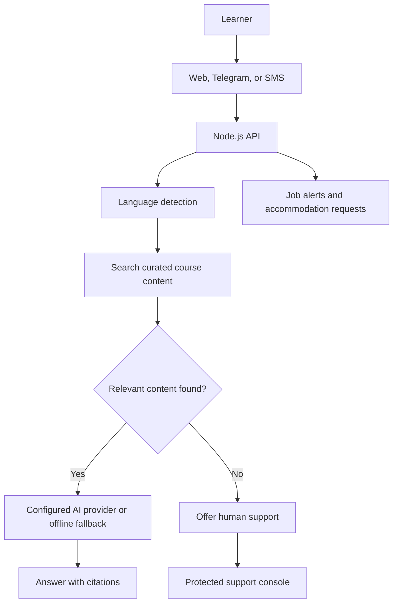

# Savanna Assistant

## Accessible, multilingual learning and career support

Savanna Assistant is an accessible learning and career-support platform. The current working languages  It answers questions using a curated course knowledge base, provides citations, and can connect learners with a human support person when the content does not cover their question.

The project also provides job information, job-alert subscriptions, and interview-accommodation requests through a web widget, Telegram bot, and SMS integration. It is configured for a local Ollama model by default, with optional Gemini/Groq providers and a built-in no-model offline fallback. The current implementation uses Node.js and browser-native JavaScript and does not require a database or front-end framework.

> **Guiding principle:** reliable course information first, AI assistance second, human support when needed.

## The problem and our approach

Learners may have trouble finding accurate answers in course materials, accessing information in their preferred language, using interfaces that do not meet their accessibility needs, or reaching a person when automated help is insufficient. Job information and interview accommodations can also be difficult to access.

Savanna Assistant addresses these needs by combining course-content retrieval and citations, English and Amharic support, accessible web interactions, human handoff, career information, and multiple communication channels. It aims to avoid presenting unsupported course answers as fact: questions with insufficient matching content are escalated rather than sent to an AI model for an ungrounded answer. Additional languages will be enabled only after language-specific content and review are available.

## Features

- **Course-grounded answers:** searches the course content and includes citations for supported answers.
- **English and Amharic:** detects language from a question; the web widget also offers language selection. Tigrinya, Afaan Oromo, Somali, and Arabic are planned, pending reviewed interface translations and course content.
- **Pluggable AI providers:** local Ollama is the default choice; Gemini and Groq are opt-in. The built-in offline provider remains the final no-model fallback.
- **Human handoff:** learners can request support and share relevant conversation context after consent.
- **Career support:** job information, job-alert subscriptions, and interview-accommodation requests.
- **Multiple channels:** embeddable web component, Telegram bot, and SMS route with a console simulator or configurable webhook adapter.
- **Accessibility features:** semantic controls, keyboard-oriented interactions, responsive layout, dark mode, and browser speech features where supported.

Features vary by channel and device. See [docs/readme.md](docs/readme.md) for channel commands, widget embedding, API details, and limitations.

## Intended users

- **Learners:** ask course questions, view citations, use available speech features, and request human assistance.
- **Job seekers:** explore job information, subscribe to alerts, and submit interview-accommodation requests.
- **Support agents:** use the protected console to review and respond to learner requests.
- **Maintainers:** configure integrations, update course and job content, and run tests.

## How it works



The retrieval and chat logic is in [api/retrieval/](api/retrieval/) and [api/chat.js](api/chat.js). Provider implementations and fallback routing are in [api/ai/](api/ai/). Human conversations and job subscriptions currently use in-memory stores.

## Technology and project layout

- **Runtime and API:** Node.js 20.12 or newer, using the native HTTP server.
- **Web interface:** browser-native JavaScript, HTML, and CSS; no front-end framework.
- **AI:** local Ollama by default, optional Gemini and Groq providers, plus a built-in offline fallback.
- **Testing:** Node.js test runner, Playwright, axe-core, and Microsoft Edge for the accessibility scan.

| Path | Purpose |
| --- | --- |
| [api/server.js](api/server.js) | HTTP server, routes, static pages, rate limits, and application wiring. |
| [api/chat.js](api/chat.js) | Grounded chat behavior and citations. |
| [api/ai/](api/ai/) | Provider implementations and fallback router. |
| [api/retrieval/](api/retrieval/) | Content loading, tokenization, and search. |
| [api/handoff/](api/handoff/) | In-memory learner/support conversations. |
| [api/sms/](api/sms/) | SMS conversation handling and console/webhook adapters. |
| [api/jobs/](api/jobs/) | Job subscriptions and alert delivery. |
| [content/](content/) | English and Amharic course and job content. |
| [widget/](widget/) | Web component, demo, support console, and SMS simulator. |
| [telegram/bot.js](telegram/bot.js) | Optional Telegram bot process. |
| [tests/](tests/) | Core tests and automated accessibility checks. |
| [docs/](docs/) | Detailed project guide and accessibility report. |

## Requirements

- Node.js **20.12 or newer** and npm.
- Microsoft Edge to run the optional Playwright accessibility scan.
- Credentials only for external integrations you choose to enable.

## Installation and local setup

Run these commands from the `savanna-assistant` project directory:

```sh
npm install
```

Create `.env` only if you do not already have one. In PowerShell:

```powershell
Copy-Item .env.example .env
```

On macOS or Linux:

```sh
cp .env.example .env
```

Set a strong random `AGENT_KEY` to enable the support console. Set `SMS_INBOUND_KEY` to enable the SMS route. Both features remain disabled when their keys are empty. For the default local AI provider, install Ollama and pull the model configured in `OLLAMA_MODEL` (the example uses `aya-expanse:8b`). Configure cloud provider keys and Telegram credentials only if you need those integrations. **Keep `.env` private; never commit real API keys, bot tokens, or other secrets.**

After installing Ollama, download the example model:

```sh
ollama pull aya-expanse:8b
```

If your existing `.env` still has an older `AI_PROVIDERS` value, set it to `ollama,offline` to use the local model first. The server falls back to the built-in offline provider if Ollama is unavailable.

Start the application:

```sh
npm start
```

Open these local pages:

| Service | URL | Notes |
| --- | --- | --- |
| Assistant demo | <http://localhost:8787/demo> | Web widget and course chat. |
| Support console | <http://localhost:8787/agent> | Requires `AGENT_KEY`. |
| SMS simulator | <http://localhost:8787/sms-demo> | Requires `SMS_INBOUND_KEY`. |
| Health check | <http://localhost:8787/health> | Reports loaded content and service status. |
| OpenAPI definition | <http://localhost:8787/v1/openapi.json> | Machine-readable API description. |

### Run the Telegram bot

The bot runs separately from the API server. Configure `TELEGRAM_BOT_TOKEN` and `API_URL` in `.env`, leave the server running, then open another terminal in the project directory and run:

```sh
npm run bot
```

For deployment, use an HTTPS API endpoint and store credentials in the hosting platform's secret manager. Telegram users must start a conversation with the bot before it can message them.

## Configuration

See [.env.example](.env.example) for settings and default values. Important variables include:

| Variable | Purpose |
| --- | --- |
| `PORT` | API port; defaults to `8787`. |
| `AI_PROVIDERS` | Provider priority; defaults to `ollama,offline`. Offline is always added as a fallback. |
| `OLLAMA_BASE_URL` | Local Ollama OpenAI-compatible API URL; defaults to `http://127.0.0.1:11434/v1`. |
| `OLLAMA_MODEL` | Ollama model name; defaults to `aya-expanse:8b`. Pull the model locally before use. |
| `GEMINI_API_KEY`, `GEMINI_MODEL` | Optional Gemini credentials and model. |
| `GROQ_API_KEY`, `GROQ_MODEL` | Optional Groq credentials and model. |
| `ADDIS_API_KEY` | Optional server-only key for Addis AI STT and TTS. Speech calls may incur pay-as-you-go charges. |
| `AI_TIMEOUT_MS` | Provider request timeout in milliseconds; defaults to `8000`. |
| `MIN_COVERAGE` | Minimum course-content match threshold; defaults to `0.3`. |
| `AGENT_KEY` | Enables and protects support-agent routes. Use a long random value. |
| `INTERNAL_KEY` | Optional shared secret for trusted internal clients such as the Telegram bot. |
| `TELEGRAM_BOT_TOKEN` | Telegram bot credential; also used for Telegram job-alert delivery. |
| `API_URL` | API base URL used by the Telegram bot; defaults to `http://localhost:8787`. |
| `SMS_INBOUND_KEY` | Enables and protects inbound SMS and the SMS simulator. Empty disables SMS. |
| `SMS_PROVIDER` | `console` for local simulation or `webhook` for an external SMS gateway. |
| `SMS_WEBHOOK_URL`, `SMS_WEBHOOK_KEY` | Destination and optional authentication for webhook SMS delivery. |
| `CORS_ORIGIN` | `*` or a comma-separated origin allowlist. |
| `RATE_LIMIT_PER_MIN` | Chat requests per IP per minute; defaults to `30`. |
| `HANDOFF_RATE_LIMIT_PER_MIN` | Handoff requests per IP per minute; defaults to `5`. |

Ollama requests use the configured endpoint. Loopback endpoints are treated as local; non-loopback endpoints are treated as external and receive cloud-style message redaction. Use a trusted local endpoint. Gemini and Groq are optional cloud providers; to disable them, set `AI_PROVIDERS=ollama,offline`. The offline provider is a basic passage-based fallback, not an equivalent replacement for an LLM.

## API overview

The full route definitions and schemas are available at `/v1/openapi.json` while the server is running. Key routes include:

| Method and route | Purpose | Access |
| --- | --- | --- |
| `GET /health` | Health and loaded-content status. | Public |
| `POST /v1/chat` | Ask a course question; returns answer and citations when grounded. | Public, rate-limited |
| `POST /v1/handoff` | Create a learner support request. | Public, rate-limited |
| `/v1/handoff/:id` | Learner reads, messages, signals, or closes a handoff. | Learner bearer token |
| `POST /v1/accommodations` | Submit an interview-accommodation request. | Public, rate-limited |
| `POST /v1/jobs/subscribe` | Subscribe to job alerts by Telegram or SMS. | Public, rate-limited |
| `POST /v1/jobs/unsubscribe` | Unsubscribe from job alerts. | Public, rate-limited |
| `/v1/agent/handoffs` | List and manage learner handoffs. | `AGENT_KEY` bearer token |
| `POST /v1/agent/jobs/broadcast` | Broadcast a job alert. | `AGENT_KEY` bearer token |
| `/v1/sms/inbound` | Receive an inbound SMS webhook request. | `SMS_INBOUND_KEY` bearer token |

## SMS integration

The default console adapter is for local simulation and development. To use a real gateway, configure `SMS_PROVIDER=webhook`, set `SMS_WEBHOOK_URL` and `SMS_WEBHOOK_KEY`, and verify that the gateway's request/response format matches [api/sms/webhook-adapter.js](api/sms/webhook-adapter.js). Provider-specific adjustments may be needed. Real SMS service requires an external gateway and its own credentials.

## Accessibility

Accessibility is a design goal, with **WCAG 2.2 Level AA** as the target—not a claim of full conformance. The web interface includes semantic controls, visible focus styles, responsive layouts, and browser-dependent voice features. Automated checks cannot replace manual testing with keyboard-only navigation, screen readers, zoom, high-contrast settings, and people with varied access needs.

The current scope and outstanding manual checks are documented in [docs/ACCESSIBILITY.md](docs/ACCESSIBILITY.md).

## Addis AI speech (optional)

When `ADDIS_API_KEY` is configured, the widget can record a short utterance for transcription and can request user-initiated generated speech for supported answers. The key stays in the server `.env`; it is never sent to the browser. Addis handles speech only: existing retrieval, Groq/other LLM providers, citations, and human handoff remain responsible for their current jobs.

**Speech languages documented by Addis Scribe:** English (`en`), Amharic (`am`), Afaan Oromo (`om`), and Tigrinya (`ti`). Speech is not the same as full language support: the current course chat/retrieval content still supports English and Amharic only. Arabic and Somali are not listed as supported Scribe or Addis Voices languages in the documentation used for this integration.

- Start speech input by choosing a speech language and pressing the microphone button. The browser asks for microphone permission only then. Stop to transcribe; cancel discards the recording. Review or edit the resulting text before submitting.
- Recordings are limited locally to **30 seconds** and **8 MB**, validated for audio format/duration on the server, sent in memory to Addis, then discarded. Browser microphone APIs generally require HTTPS in deployment (localhost is allowed for development).
- Each answer has the existing browser read-aloud option. For Amharic, Afaan Oromo, and Tigrinya, **Listen (Addis voice)** can generate an MP3; native audio controls provide playback, pause/resume, seeking, and replay. No audio plays until the learner activates a control.
- STT/TTS are pay-as-you-go, not guaranteed free-tier services. Addis documentation currently lists STT at **3.5 ETB per 1,000 transcript characters** and Voices 2 at **5 ETB per generated minute**. Check the [official pricing](https://docs.addisassistant.com/docs/platform/pricing) and wallet before using; pricing may change. The app applies per-IP rate limits, but those are not a spending cap.
- TTS obtains a currently available voice ID from the Addis voice catalog instead of hard-coding one. Generated audio uses a signed URL and is not retained by Savanna.

See [docs/readme.md](docs/readme.md#speech-services-addis-ai) for endpoints, provider behavior, and troubleshooting.

## Tests

Run the automated core suite:

```sh
npm test
```

To run the accessibility checks, start the server with `npm start` in one terminal, then run in a second terminal:

```sh
npm run a11y
```

The scan uses Playwright and Microsoft Edge to check `/demo`, `/agent`, and `/sms-demo` in light/dark color schemes and at a narrow viewport. It also checks some widget states. Test output reports the current results.

## Privacy, security, and limitations

- Human handoff is intended to share conversation context only after learner consent. Support routes require `AGENT_KEY`.
- Accommodation requests should not require a diagnosis; avoid entering unnecessary sensitive information.
- Handoff conversations and job subscriptions are stored in memory. They are lost when the server restarts and are not shared across multiple server instances.
- Configure production secrets through a secret manager, restrict CORS to trusted origins, and use HTTPS for public deployments.
- Real Telegram and SMS delivery require valid credentials and external service configuration.
- Browser voice support varies by browser, operating system, and installed speech voices; Amharic voice support may not be available.
- Screen sharing uses WebRTC with STUN only. Some networks may require TURN for reliable connections.
- Amharic course and job text should be reviewed by fluent speakers before production use. Additional languages are planned, not currently supported.
- Telegram alerts can only reach users who have initiated a conversation with the bot.

## Demonstration walkthrough

1. Open `/demo`, choose a language, and ask a question covered by the course content. Show the cited source.
2. Ask an unsupported question and demonstrate the human-support option.
3. If `AGENT_KEY` is configured, open `/agent` and respond to a consented handoff.
4. Demonstrate the accommodation form or SMS simulator if its key is configured.
5. Demonstrate Telegram or real SMS only when the corresponding integration has been configured and tested.

Clearly distinguish working integrations from simulator, prototype, or planned behavior during a presentation.

## Future development

Potential next steps include persistent storage with appropriate consent and retention policies, manual accessibility testing with NVDA and other assistive technologies, fluent-speaker review and expansion to Tigrinya, Afaan Oromo, Somali, and Arabic, job-alert preferences, production monitoring, and load testing. These are future improvements, not claims about the current implementation.

## Documentation and license

- Detailed feature guide, channel commands, and widget embedding: [docs/readme.md](docs/readme.md)
- Accessibility scope and manual test status: [docs/ACCESSIBILITY.md](docs/ACCESSIBILITY.md)
- API reference: `/v1/openapi.json` while the server is running
- License: MIT is declared in [package.json](package.json)

**Savanna Assistant — accessible learning, reliable answers, human support, and opportunity.**